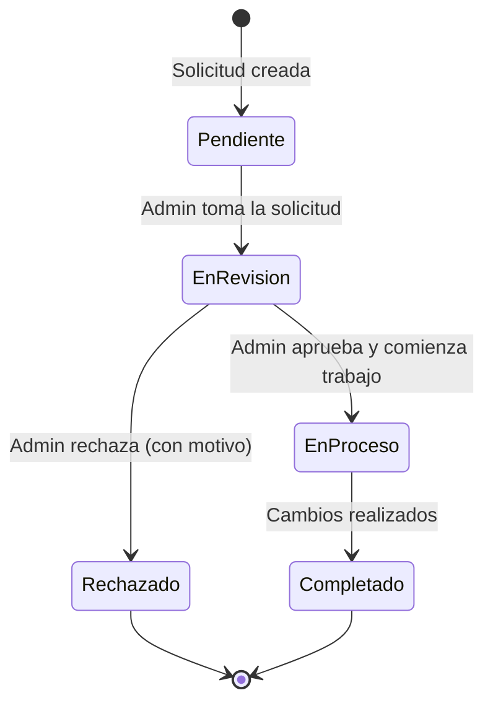
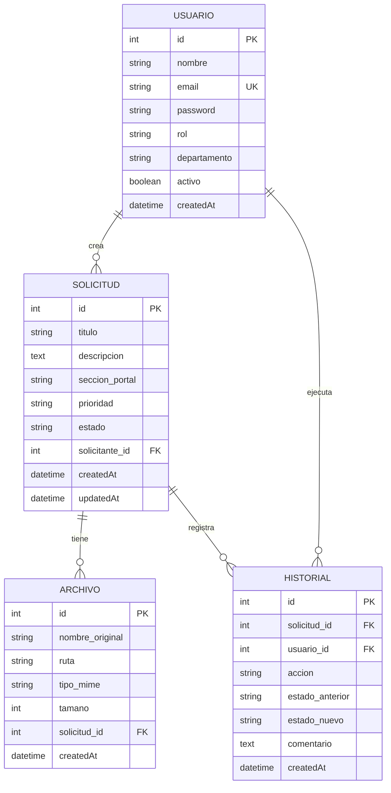

# 📋 Sistema de Gestión de Solicitudes de Actualización de Contenido Web (SGSACW)

> **Proyecto de Prácticas Pre-Profesionales**  
> **Institución**: Universidad Privada de Tacna — Oficina TEIN (Tecnologías de la Información)  
> **Practicante**: Rodrigo Soto  

---

## 1. Descripción del Problema

La Oficina de Tecnologías de la Información (TEIN) de la Universidad Privada de Tacna recibe documentos Word de diversos departamentos y carreras de la universidad, solicitando cambios o actualizaciones en sus respectivas secciones del portal web institucional. Este proceso se realiza de forma manual y desorganizada, lo que genera:

- **Pérdida de trazabilidad**: No hay registro formal de qué se solicitó, cuándo ni por quién.
- **Dificultad de seguimiento**: Los departamentos no saben en qué estado se encuentra su solicitud.
- **Desorganización**: Documentos recibidos por múltiples canales (correo, USB, físico) sin un punto centralizado.
- **Falta de historial**: No hay bitácora de cambios realizados en el portal.

## 2. Solución Propuesta

Desarrollar un **Sistema Web de Gestión de Solicitudes** que digitalice y centralice el proceso de recepción, seguimiento y ejecución de solicitudes de actualización de contenido web del portal universitario.

## 3. Stack Tecnológico

| Componente | Tecnología |
|------------|------------|
| **Frontend** | React + Next.js (App Router) |
| **Backend** | Next.js API Routes (Node.js) |
| **Base de Datos** | SQLite (desarrollo rápido) / PostgreSQL |
| **ORM** | Prisma |
| **Autenticación** | NextAuth.js / JWT con bcrypt |
| **Estilos** | Tailwind CSS |
| **Almacenamiento de archivos** | Sistema de archivos local (uploads/) |

## 4. Módulos del Sistema

### 4.1 Autenticación y Roles

| Rol | Permisos |
|-----|----------|
| **Administrador (TEIN)** | Ver todas las solicitudes, cambiar estados, asignar, ver historial completo, gestionar usuarios |
| **Solicitante (Departamento)** | Crear solicitudes, subir archivos, ver sus propias solicitudes y su estado |

- Registro de usuarios y login con email y contraseña
- Sesiones seguras con JWT / cookies
- Control de acceso por rol

### 4.2 Gestión de Solicitudes

Cada solicitud contiene:

| Campo | Tipo | Descripción |
|-------|------|-------------|
| `titulo` | Texto | Título descriptivo del cambio solicitado |
| `descripcion` | Texto largo | Detalle de los cambios requeridos |
| `seccion_portal` | Texto | Sección del portal web a modificar |
| `prioridad` | Enum | Baja, Media, Alta, Urgente |
| `departamento` | Texto / Relación | Departamento que solicita |
| `archivos` | Archivos | Documentos Word, imágenes, PDF adjuntos |
| `estado` | Enum | Estado actual de la solicitud |
| `fecha_creacion` | Timestamp | Fecha de creación automática |
| `fecha_actualizacion` | Timestamp | Última modificación |

### 4.3 Flujo de Estados



| Estado | Descripción |
|--------|-------------|
| **Pendiente** | Solicitud recién creada, sin atender |
| **En Revisión** | El admin está revisando la solicitud |
| **En Proceso** | Los cambios están siendo implementados |
| **Completado** | Cambios realizados exitosamente |
| **Rechazado** | Solicitud rechazada (se registra el motivo) |

### 4.4 Archivos Adjuntos

- Formatos permitidos: `.docx`, `.doc`, `.pdf`, `.png`, `.jpg`, `.jpeg`
- Tamaño máximo por archivo: 10 MB
- Múltiples archivos por solicitud
- Descarga y visualización directa desde el sistema

### 4.5 Historial / Bitácora

Cada acción queda registrada automáticamente:

- Creación de solicitud
- Cambios de estado (con fecha, usuario y comentario)
- Archivos subidos
- Modificaciones a la solicitud

### 4.6 Búsqueda y Filtrado

- Filtrar por: estado, departamento, prioridad, rango de fechas
- Búsqueda por texto en título y descripción
- Ordenar por: fecha, prioridad, estado

## 5. Estructura de Páginas

```
/ (Landing / Login)
├── /login
├── /register
├── /dashboard
│   ├── Vista Solicitante: Mis solicitudes + Crear nueva
│   └── Vista Admin: Todas las solicitudes + Filtros
├── /solicitudes
│   ├── /nueva          → Formulario de nueva solicitud
│   └── /[id]           → Detalle de solicitud + historial + archivos
└── /usuarios           → (Solo Admin) Gestión de usuarios
```

## 6. Modelo de Base de Datos (Entidades)



## 7. Requerimientos No Funcionales

- **Responsivo**: Adaptable a móvil, tablet y escritorio
- **Seguridad**: Contraseñas hasheadas (bcrypt), sesiones con tokens seguros, validación de archivos
- **Rendimiento**: Paginación en listados, carga eficiente de archivos
- **Usabilidad**: Interfaz moderna e intuitiva con Tailwind CSS

## 8. Progreso del Desarrollo

- [x] Estructura base del proyecto creada (`sgsacw` con Next.js)
- [x] Configuración de Prisma y Base de Datos (SQLite + seed de datos)
- [x] Autenticación (registro, login, roles ADMIN y SOLICITANTE, JWT)
- [x] CRUD de solicitudes con códigos correlativos (SOL-YYYY-XXX)
- [x] Subida y descarga de archivos adjuntos (Word, PDF, Imágenes)
- [x] Flujo de estados con bitácora e historial inmutable
- [x] Búsqueda y filtrado dinámico (estado, prioridad, departamento, texto)
- [x] Interfaz UI completa y responsiva (Tailwind CSS, Dashboard, Formularios, Detalle)
- [x] Verificación y compilación de producción exitosa (`next build` 0 errores)
